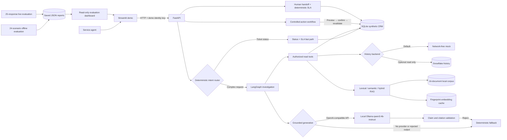

# Salesforce Servicing Agent — FDE Proof of Concept

An evaluation-driven customer-servicing agent that combines deterministic service
workflows, evidence-grounded investigation, controlled CRM actions, and optional
local LLM generation. It is designed as a Salesforce Forward Deployed Engineer
technical demonstration: the business objective is explicit, trust boundaries are
visible, risky actions remain deterministic, and every measured result is backed by
a checked-in evaluation artifact.

> **Scope:** all customers, cases, policies, entitlements, CRM writes, queues, and
> evaluation questions are synthetic. SQLite simulates the operational CRM. The
> optional Snowflake adapter reads synthetic history only. There is no live
> Salesforce integration, production authentication, or financial transaction.

## Project overview

Service teams often need to reconcile current CRM state, historical interactions,
product guidance, customer entitlements, and policy versions before answering a
seemingly simple question. A conversational layer can reduce that research burden,
but only if it prevents cross-customer leakage, distinguishes current facts from
history, cites applicable evidence, and gates writes behind deterministic controls.

This PoC tests that operating model through three paths:

1. **Deterministic servicing** for authoritative ticket status and SLA rules.
2. **LangGraph investigations** for authorized CRM, Snowflake, and RAG evidence.
3. **Controlled actions** for confirmation-gated notes, idempotent recovery, and
   human handoff.

The intended business hypotheses are improved CPRR, CSAT, time to resolution
(TTR), SLA compliance, and repeat-contact rate. The repository does **not** claim
improvement in any of those KPIs: it measures technical task completion, retrieval,
grounding, authorization, action safety, escalation behavior, and latency over
synthetic scenarios.

## Architecture



### Component responsibilities

| Component | Implemented responsibility |
|---|---|
| Streamlit | Demo scenarios, chat, citations, stage latency, traces, controlled-action controls, escalation status, and saved evaluation dashboards. |
| FastAPI | Health, chat, note-operation, handoff, and SLA endpoints with server-resolved demo-user context. |
| Intent router | Regex-based ticket-status fast path; no LLM, LangGraph, or RAG invocation for explicit status requests. |
| LangGraph | Four-step complex-request workflow: triage, authorized case context, grounded evidence, and response composition. A separate minimal graph executes note commands. |
| SQLite | Synthetic customers, cases, entitlements, current ticket state, operation journal, notes, handoffs, record versions, and SLA deadlines. It remains authoritative for current status. |
| Snowflake | Optional RSA-authenticated, read-only history from `CUSTOMER_ACTIVITY`, `CASE_HISTORY`, and `SUPPORT_INTERACTIONS`; it never overrides current CRM state. |
| Hybrid RAG | Lexical ranking, CPU MiniLM cosine similarity, and Reciprocal Rank Fusion (RRF, default `k=60`) over approved, applicable, authorized documents. |
| Generation | Deterministic evidence synthesis by default/fallback, or optional OpenAI-compatible Ollama generation with output, claim, polarity, and citation checks. |

## Key capabilities

- **Deterministic ticket servicing:** returns current status, owner, priority, last
  update, and SLA state directly from authorized CRM data.
- **Multi-source investigation:** combines current CRM facts, verified
  entitlements, approved RAG documents, and optional Snowflake history.
- **Evidence-grounded answers:** returns inline source identifiers and snippets;
  missing, conflicting, outdated, or inapplicable evidence produces uncertainty
  instead of a fabricated conclusion.
- **Customer-specific policy applicability:** filters by product, active
  entitlement, tier, approval status, effective date, and document version. The
  newest policy is not automatically treated as applicable.
- **Controlled ticket notes:** prepare/preview, explicit customer-confirmation
  attestation, authorization and record-version revalidation, atomic save, cancel,
  and unknown-outcome reconciliation.
- **Human escalation:** authorized handoffs carry permitted case context, source
  references, and troubleshooting history through `CREATED`, `ACCEPTED`, and
  `RESOLVED` states.
- **Deterministic SLA monitoring:** request-time checks and a one-shot CLI sweep
  create at most one escalation per case/deadline and simulate backup routing for
  unaccepted handoffs.
- **Observability:** structured JSON events and API/UI diagnostics record execution
  IDs, modes, rankings, selected evidence, stage latency, state transitions, and
  safe failure categories.

## Engineering decisions

### Hybrid orchestration

Not every service request benefits from an agent loop. The status path is faster,
more predictable, and easier to audit as deterministic application code. LangGraph
is reserved for complex read investigations where ordered tool orchestration and a
compact shared state are useful. Writes and SLA decisions stay in application
services and database transactions rather than being delegated to model reasoning.

### Hybrid retrieval

Lexical retrieval is strong for case IDs, policy phrases, and exact service terms;
semantic retrieval is useful for customer paraphrases. RRF combines both rankings
without introducing a reranker or vector database. The corpus is small enough for
local CPU embeddings, and a fingerprinted JSON cache invalidates when the model or
document text changes. If Sentence Transformers cannot initialize, semantic and
hybrid modes explicitly fall back to lexical retrieval and report the reason.

### Application-level safeguards

Authorization, entitlement validation, effective-date filtering, SLA rules, action
confirmation, idempotency, and output validation are enforced outside the LLM.
Protected documents are filtered before query ranking, so unauthorized content
cannot enter result rankings, prompts, citations, or request diagnostics. The local
corpus-wide embedding cache can contain vectors for protected synthetic documents;
it is a local demo artifact, not a tenant-isolated production vector store. This
keeps the model inside a bounded evidence-synthesis role rather than treating it as
the policy or authorization engine.

## Enterprise safeguards

| Control | Current implementation |
|---|---|
| Identity and record authorization | The `X-Demo-User` header selects a key; permissions come only from a server-side registry. Every CRM, entitlement, history, evidence, action, and handoff read rechecks customer access. This is a demo control, not production authentication. |
| Tenant-safe retrieval | Customer/case filtering precedes lexical and semantic ranking. Snowflake queries include parameterized customer and, where applicable, case predicates; returned identifiers are verified again. |
| Claim validation | LLM output is rejected for missing/irrelevant citations, exposed reasoning, partial completion, unsupported certainty or negation, root causes, and future-resolution promises. Rejection activates a labeled deterministic fallback. |
| Confirmation-gated writes | A note is previewed before any mutation. Confirmation revalidates user access and the ticket `record_version`; stale confirmations fail with a conflict. |
| Idempotency and retry safety | Durable operation IDs and database uniqueness prevent duplicate note/handoff writes. Reusing an ID with different content is rejected. Callers can safely retry with the same ID. |
| Unknown outcomes | A simulated timeout after commit produces `UNKNOWN`; reconciliation searches by the unique operation ID and transitions to `COMPLETED` without another write. This is not a claim of exactly-once behavior for an external CRM API. |
| Deterministic escalation | SLA deadlines and backup-routing rules execute independently of the LLM. Handoff transitions are validated and journaled. |
| Snowflake isolation | RSA key-pair authentication, verified role/database/schema, bounded query timeouts, approved columns, `SELECT`-only application code, connection cleanup, and no silent mock fallback after a real failure. |
| Auditability | SQLite operation/handoff records plus structured events capture operation IDs, state transitions, latency, outcomes, and safe error categories. Secrets, private-key contents, and Snowflake rows are not logged. |

The application does not implement a general automatic retry loop or circuit
breaker. Read failures are surfaced safely; write retry behavior relies on stable
operation IDs and reconciliation.

## Repository layout

```text
.
├── src/servicing_agent/
│   ├── api.py, service.py, workflow.py       # API and orchestration
│   ├── database.py, tools.py, auth.py        # synthetic CRM and authorization
│   ├── retrieval.py, corpus/knowledge.json   # local RAG
│   ├── history.py                            # mock/Snowflake adapter
│   ├── generation.py                         # deterministic + optional LLM
│   ├── actions.py, handoffs.py, sla.py       # controlled operations
│   └── evaluation*.py, benchmark_ollama.py   # repeatable evaluation
├── evaluations/
│   ├── golden_questions.json                 # 24 offline contracts
│   ├── latest_results.json                   # current offline report
│   └── live_ollama/latest.json               # saved live report
├── snowflake/                                # idempotent synthetic seed SQL
├── tests/
├── .env.example
└── pyproject.toml
```

## Setup on Windows

### Prerequisites

- Windows PowerShell and Python 3.11+
- Ollama only for optional local LLM generation
- A synthetic Snowflake environment and encrypted RSA private key only for the
  optional live-history path

### 1. Create the environment

From the repository root:

```powershell
py -3.11 -m venv .venv
Set-ExecutionPolicy -Scope Process -ExecutionPolicy Bypass
.\.venv\Scripts\Activate.ps1
python -m pip install --upgrade pip
python -m pip install -e ".[dev]"
```

For semantic/hybrid retrieval on Windows CPU, install the CPU PyTorch wheel and
the semantic extra:

```powershell
python -m pip install torch --index-url https://download.pytorch.org/whl/cpu
python -m pip install -e ".[dev,semantic]"
```

Add the Snowflake connector only when needed:

```powershell
python -m pip install -e ".[dev,semantic,snowflake]"
```

### 2. Configure the root `.env`

```powershell
if (-not (Test-Path .env)) { Copy-Item .env.example .env }
```

[`servicing_agent.settings`](src/servicing_agent/settings.py) resolves the root
`.env` independently of the current working directory. Explicit process variables
override file values. `.env`, `.p8`, and `.pem` files are ignored by Git.

The tracked [`.env.example`](.env.example) is the complete variable inventory.
The most important controls are:

| Area | Variables and safe local defaults |
|---|---|
| Data | `SERVICE_AGENT_DB_PATH=data/service_agent.db` |
| Retrieval | `RETRIEVAL_MODE=lexical`; use `hybrid` after initializing embeddings. Model: `sentence-transformers/all-MiniLM-L6-v2`; `RETRIEVAL_TOP_K=5`; `RETRIEVAL_RRF_K=60`. |
| History | `HISTORY_BACKEND=mock` performs no network request. Use `snowflake` only with all required credentials below. |
| LLM | `SERVICE_AGENT_LLM_PROVIDER=openai_compatible`, model `qwen3:4b-instruct`, base URL `http://localhost:11434/v1`, bounded `120`-second generation timeout and `512` output tokens. Missing/unavailable Ollama uses the deterministic fallback. Set provider to `none` for deterministic-only operation. |
| API/UI | API `127.0.0.1:8000`, Streamlit `127.0.0.1:8501`, UI-to-API read timeout `240` seconds. |
| Evaluation | Dataset/result paths, modes, runs, fixed date/clock, and configured-LLM opt-in use the `EVALUATION_*` variables. |

Snowflake mode additionally requires:

```dotenv
HISTORY_BACKEND=snowflake
SNOWFLAKE_ACCOUNT=your-account-identifier
SNOWFLAKE_USER=SERVICING_AGENT_SVC
SNOWFLAKE_ROLE=SERVICING_HISTORY_READER
SNOWFLAKE_WAREHOUSE=SERVICING_POC_WH
SNOWFLAKE_DATABASE=SERVICING_AGENT_DEMO
SNOWFLAKE_SCHEMA=HISTORY
SNOWFLAKE_PRIVATE_KEY_FILE=C:/Users/your-user/.snowflake/keys/servicing_agent_key.p8
SNOWFLAKE_PRIVATE_KEY_PASSPHRASE="your-local-passphrase"
```

The connector passes the encrypted-key path and passphrase directly using
`SNOWFLAKE_JWT`; there is no interactive prompt. Never commit or print `.env`, the
passphrase, or private-key material. The application role must remain read-only.

### 3. Initialize local data and embeddings

```powershell
python -m servicing_agent.demo_reset
python -m servicing_agent.index_embeddings
```

The reset is atomic, local-only, and repeatable. It restores three customers, five
cases, four entitlements, and removes demo-created notes, operations, and handoffs.
Embedding initialization downloads MiniLM on first use and writes a fingerprinted
cache under `data\embedding_cache`.

### 4. Optional local Ollama

```powershell
ollama serve
ollama pull qwen3:4b-instruct
```

The existing OpenAI-compatible client calls Ollama; no separate Ollama SDK is used.
The placeholder API key is `ollama` and is not a credential. Restart FastAPI after
changing `.env`.

### 5. Run the application

Terminal 1:

```powershell
.\.venv\Scripts\Activate.ps1
python -m servicing_agent.api
```

Terminal 2:

```powershell
.\.venv\Scripts\Activate.ps1
python -m servicing_agent.run_streamlit
```

Open <http://localhost:8501>. FastAPI health and OpenAPI are available at
<http://localhost:8000/health> and <http://localhost:8000/docs>.

## Demo scenarios

Reset before a repeatable demonstration:

```powershell
python -m servicing_agent.demo_reset
```

| Scenario | Prompt or action | Expected behavior |
|---|---|---|
| Deterministic status | `What is the status of CASE-4821?` | Authorized SQLite lookup returns `In Progress`, priority, owner, timestamp, and deterministic overdue-SLA state without RAG or LLM generation. |
| Multi-source investigation | Ask why CASE-4821 was escalated and what delay the customer observed. | Complex workflow retrieves the protected case note and call transcript; the answer reports the three degraded windows and observed 40–60-minute delay with citations. Snowflake history is included only when enabled and authorized. |
| Premium applicability | `What initial response target applies to CASE-4821?` | Active Premium telemetry entitlement selects approved policy v2.0 and its two-clock-hour target. |
| Standard applicability | `What initial response target applies to CASE-4824?` | Active Standard telemetry entitlement selects approved policy v1.0 and its eight-business-hour target; one recovered retry does not imply required escalation. |
| Unknown diagnostics | Ask whether CASE-4821 diagnostic logs were received. | Evidence confirms the request but not receipt; the response does not infer that logs were received, refused, or never sent. |
| Confirmed resolution | Ask what resolved CASE-4825. | Evidence supports the expired certificate, completed rotation/replay, cleared backlog, and resolved status without transferring those facts to CASE-4821. |
| Unauthorized access | As Jordan, ask about CASE-4821. | Authorization fails before Snowflake or protected retrieval; no protected rankings, prompt context, snippets, or citations are returned. |
| Controlled note | Prepare, preview, attest confirmation, and save a CASE-4821 note. | Repeated confirmation returns the same operation/result. A changed ticket version rejects stale confirmation. |
| Timeout recovery | Confirm with timeout simulation, then reconcile. | State moves `PENDING → UNKNOWN → COMPLETED`; the unique operation ID prevents a second note. |
| Human handoff | Create, accept, and resolve an authorized CASE-4821 handoff. | Permitted context, troubleshooting history, and source references follow validated lifecycle transitions. |
| SLA backup routing | Run the sweep twice using the fixed times below. | One SLA handoff is created; the unaccepted handoff moves to the simulated backup queue after 15 minutes. |

```powershell
python -m servicing_agent.sla_sweep --as-of "2026-11-08T12:00:00Z"
python -m servicing_agent.sla_sweep --as-of "2026-11-08T12:20:00Z"
```

Snowflake seed data is maintained by idempotent, stable-ID `MERGE` statements in
[`snowflake/seed_synthetic_history.sql`](snowflake/seed_synthetic_history.sql).
Run that script only as the synthetic-data owner; never grant write privileges to
`SERVICING_HISTORY_READER`.

## Evaluation

### Offline deterministic evaluation

The current report, [`evaluations/latest_results.json`](evaluations/latest_results.json),
was generated on November 9, 2026 from 24 synthetic contracts, three runs per
retrieval mode, the deterministic answer generator, mock history, CPU MiniLM, and
warm caches. Each mode therefore represents 72 scenario runs.

| Mode | Task success | Recall@5 | Precision@3 | Grounded answer | Policy applicability | Failed runs |
|---|---:|---:|---:|---:|---:|---:|
| Lexical | 0.9167 | 0.8750 | 0.3056 | 0.8824 | 1.0000 | 6 / 72 |
| Semantic | 0.8750 | 0.8333 | 0.2778 | 0.8235 | 0.6667 | 9 / 72 |
| Hybrid | 1.0000 | 1.0000 | 0.3611 | 1.0000 | 1.0000 | 0 / 72 |

| Mode | Retrieval P50 / P95 | Tool P50 / P95 | End-to-end P50 / P95 |
|---|---:|---:|---:|
| Lexical | 0.117 / 0.155 ms | 4.591 / 41.148 ms | 8.762 / 107.793 ms |
| Semantic | 13.452 / 18.142 ms | 16.322 / 49.213 ms | 24.235 / 119.496 ms |
| Hybrid | 16.039 / 22.528 ms | 22.398 / 49.395 ms | 29.846 / 122.702 ms |

All three modes measured `1.0000` authorization safety, action safety, escalation
correctness, recovery success, claim/citation relevance, and unsupported-claim
avoidance in this artifact. Hybrid satisfied all 24 contracts; this is a small
synthetic regression result, not evidence that hybrid retrieval is universally
superior.

Run the network-independent evaluation with:

```powershell
python -m servicing_agent.evaluation
```

### Live Ollama + Snowflake evaluation

[`evaluations/live_ollama/latest.json`](evaluations/live_ollama/latest.json)
contains one warm-up plus 25 measured responses: five runs each for scenarios 2–6
using real Snowflake history, hybrid retrieval, and local
`qwen3:4b-instruct`. The benchmark was generated on November 10, 2026; revised
quality dimensions were later calculated from the same saved responses without
new Ollama or Snowflake calls.

| Automated metric | Measured result |
|---|---:|
| LLM generation success / fallback | 100% / 0% |
| Citation validity / claim-citation relevance | 100% / 100% |
| Revised semantic correctness | 100% |
| Revised factual completeness | 100% |
| Revised claim grounding | 100% |
| Revised formatting compliance | 100% |
| Legacy exact contract / legacy grounding contract | 60% / 80% |

The legacy mismatch reflects exact deterministic wording/format requirements; it
is retained for auditability rather than reclassified as model success. No human
answer-quality review was performed.

| Warm-request latency | P50 | P95 |
|---|---:|---:|
| Model generation | 11.08 s | 13.70 s |
| End to end | 14.34 s | 18.28 s |

The excluded cold request took `84.18 s`: retrieval/model initialization
`45.79 s`, Snowflake `7.59 s`, and generation `30.78 s`. These values are
machine-specific and should not be treated as a production SLO.

Re-score an existing live artifact without calling either integration:

```powershell
python -m servicing_agent.benchmark_ollama `
  --reevaluate evaluations\live_ollama\latest.json
```

Running `python -m servicing_agent.benchmark_ollama --runs 5` performs a new,
expensive 25-request live benchmark and requires Snowflake, hybrid retrieval, and
Ollama to be configured.

### Tests

```powershell
python -m pytest
```

The current suite collects 135 tests: 130 run offline and five live integration
tests are opt-in. Unit tests mock embeddings and connectors, so normal test runs do
not download models or contact Snowflake/Ollama. To opt into live integrations,
configure `.env` and set `RUN_SNOWFLAKE_INTEGRATION=1` and/or
`RUN_OLLAMA_INTEGRATION=1` for that process.

### Evaluation limitations

- The corpus contains 16 synthetic documents and the offline dataset contains 24
  contracts; neither represents production distribution or long-tail behavior.
- Automated citation validity confirms accepted labels and deterministic relevance
  checks, not independent factual truth.
- Live results cover one local model, one machine, five scenario types, and five
  measured repetitions each; no confidence intervals or comparative human study
  were performed.
- Latency excludes model download and uses warm caches except for the separately
  reported cold request.
- CSAT, CPRR, TTR, SLA improvement, repeat-contact reduction, ROI, and production
  case deflection were not measured.

## Known limitations

- **Cold-start latency:** CPU model/index initialization dominated the measured
  cold request. A long-lived process, pre-warming, or managed inference would be
  needed for production latency targets.
- **Retrieval precision:** the small corpus and top-three measurement produce low
  precision even when required evidence is found. There is no reranker, vector
  database, learned relevance model, or production threshold calibration.
- **Synthetic CRM:** current state, actions, confirmation, and queues are SQLite
  simulations. `X-Demo-User` is not an identity provider, and local files are not
  encrypted.
- **Limited operational resilience:** there is no continuously running SLA
  scheduler, distributed lock, message queue, automatic retry policy, circuit
  breaker, or multi-instance coordination.
- **Local generation:** Ollama is optional and safely falls back, but model safety,
  cost, throughput, and quality have not been validated at production scale.
- **Snowflake scope:** the adapter has been tested against synthetic history only;
  it is not a production security certification or data-governance review.
- **Evaluation coverage:** golden contracts are useful regressions but can share
  assumptions with the implementation. Human review and adversarial evaluation are
  still required.

## Production roadmap

1. **Integrate Salesforce as the system of record.** Replace demo headers and
   SQLite CRM services with production identity, least-privilege Salesforce APIs,
   field-level security, record sharing, mutation preconditions, and platform audit
   events. Keep Snowflake historical context read-only unless a separately governed
   write use case is approved.
2. **Evaluate Agentforce versus LangGraph.** Implement the same golden tasks and
   safety contracts in Agentforce and compare CRM-native actions, authorization,
   grounding, observability, latency, customization, operational ownership, and
   total cost. Select per workflow rather than assuming one orchestrator for every
   request.
3. **Production hardening.** Add enterprise SSO/OAuth, secret management, encryption,
   PII controls, prompt/version governance, durable distributed state, bounded
   retries and circuit breakers, rate limits, asynchronous work queues, monitoring,
   alerting, red-team tests, and runbooks.
4. **KPI-driven pilot.** Establish baselines for CPRR, CSAT, TTR, SLA compliance,
   and repeat contacts; begin with read-only shadowing, then a small agent cohort and
   confirmation-gated actions. Measure quality and safety alongside business KPIs,
   review failures with service leaders, and define rollback criteria before wider
   rollout.

## License and data

No license file is currently included. All repository data is synthetic and for
local demonstration only.
